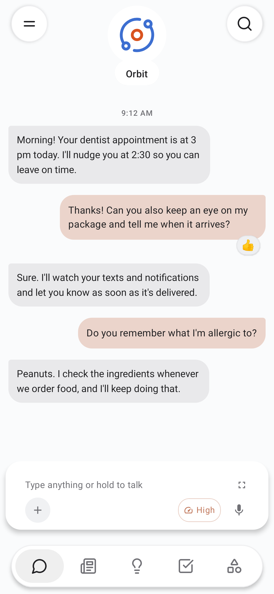
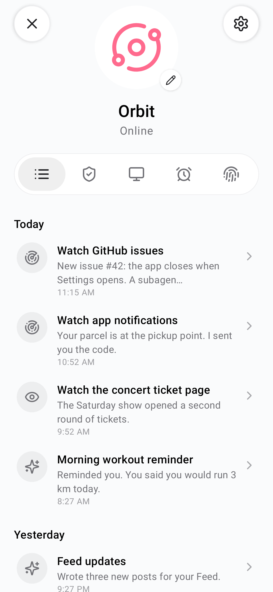
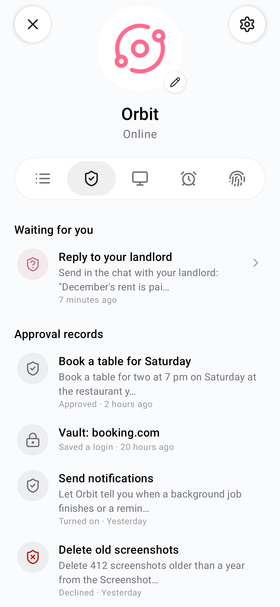
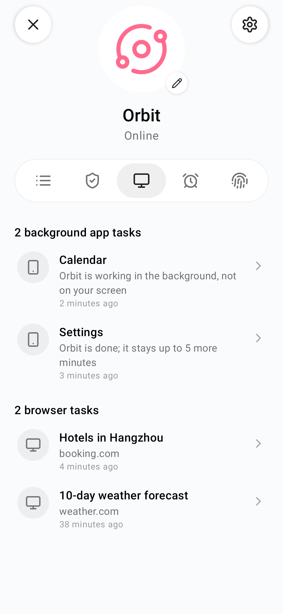
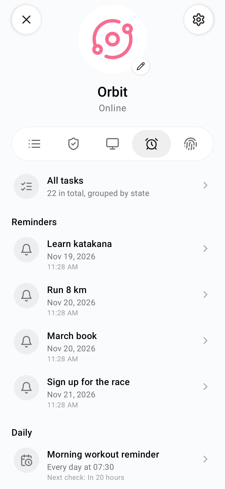
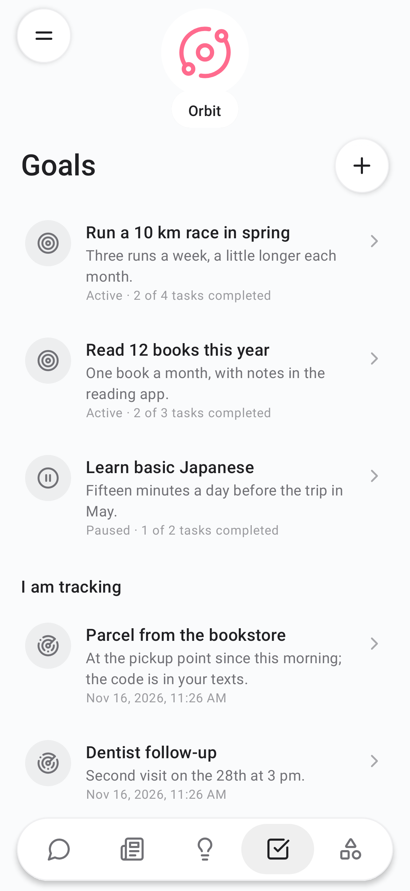
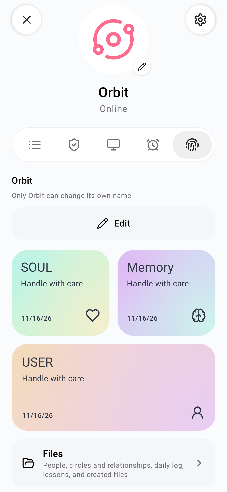

  <picture>
    <source media="(prefers-color-scheme: dark)" srcset="docs/assets/readme/orbit-banner-dark.svg">
    
  </picture>

  <b>A local-first personal AI companion on your Android phone — it knows you, gets hands-on work done, is uniquely yours, and grows with you.</b>

  
  
  
  

  <a href="https://github.com/CATMIAOZHI/orbit/releases/latest">Download</a> ·
  <a href="README.zh-CN.md">中文</a>

---

In a vast universe, you are the sun at the center, and Orbit is the planet that circles you. The logo says exactly that: the core is you; the ring and its two moons are Orbit.

Orbit is a **local-first** personal AI companion and assistant living directly on your Android phone. It keeps its memory, personality, and files on your device with no relay server in between, and grows through daily conversations, nightly reviews, and your corrections into a companion that is uniquely yours. It also comes with a **Linux terminal, built-in browser engine, background Android app control**, and **direct WeChat messaging**, so it can both talk with you and get real tasks done.

  
  &nbsp;
  
  &nbsp;
  

## Why Orbit

| Pillar | How Orbit works |
|---|---|
| **Local-first** | Memory, personality (`SOUL.md`), chats, files, vault secrets, and browser logins stay on your phone with no relay server |
| **Switch models, keep the same companion** | Switch freely across major cloud providers, OpenAI-compatible endpoints (including LAN), and multi-account pools while memory and personality stay on device |
| **Uniquely yours over time** | Reviews conversations overnight, learns from your corrections, and distills working methods into reusable Skills |
| **Gets hands-on work done** | Built-in Linux terminal, built-in browser engine, background Android app control, plus chatting with Orbit right from WeChat |

## What Orbit can do

- **Local memory that keeps growing**: facts, preferences, people, and promises live in local memory and identity files on your phone. Orbit reviews conversations overnight, learns from your corrections, and turns working methods into reusable Skills.
- **Built-in Linux terminal**: run scripts, write code, work with repos and local files, and dispatch subagents for longer jobs.
- **Built-in browser engine**: isolated logins for browsing, filling forms, and taking action; jump in anytime to sign in or pass a check, then hand it back — or open it manually for yourself.
- **Background Android app control**: operates other Android apps on a background virtual display without taking over your screen, with human takeover anytime (requires Shizuku / ADB debugging or root, subject to device and app support).
- **Proactive companionship: Feed, Ideas & Goals**: short posts written around your interests, ideas for things to do together, and long-term goals it tracks with you.
- **Background schedules & watches**: reminders, recurring tasks, and watches on notifications, texts, calendar events, web pages, or locations; watches that support programmatic pre-checks can stay silent and skip model calls when nothing changed.
- **Its own voice & reading companion**: with Xiaomi MiMo, design a voice from a text description or clone a voice sample for expressive voice messages (long-press to transcribe); paired with a compatible [Legado](https://github.com/CATMIAOZHI/legado) build and reading companion enabled, Orbit writes paragraph notes ahead of you.
- **Transparent, safe & under your control**: configure tool permissions so actions that need confirmation ask for your approval first; task runs and approval records are viewable day by day; vault secrets saved through secure cards are encrypted locally and kept out of chat context when used by tools; payments always stay with you.

## Chat with Orbit on WeChat

Reach your Orbit from WeChat like chatting with a friend — without opening the app:

- **Scan to pair your own bot**: connect in **Settings → Message channels → WeChat** to send text, voice messages (transcribed by WeChat), images, and files straight from WeChat.
- **Two-way sync, cleanly separated**: Orbit's replies, images, and files go back to WeChat and are archived inside a dedicated **WeChat** channel in Orbit without cluttering your main chat.
- **Clear privacy boundary**: this WeChat link receives only messages sent to your paired bot — it does not read your contacts, group chats, or other WeChat conversations, and cannot message anyone else.

## A closer look

<table>
<tr>
<td width="33%" align="center"> <b>Task runs</b>, day by day</td>
<td width="33%" align="center"> <b>Asks when confirmation is needed</b>, with records</td>
<td width="33%" align="center"> <b>Browser and background apps</b> you can take over</td>
</tr>
<tr>
<td align="center"> <b>Schedules</b> and watches</td>
<td align="center"> <b>Goals</b> it follows with you</td>
<td align="center"> <b>Soul and memory</b> it keeps on your phone</td>
</tr>
</table>

## How the author uses it every day

- *"Keep an eye on the latest PC release news for GTA 6 and tell me when there is real progress."*
- *"Review my Binance trades every week and summarize the lessons learned."*
- *"Inspect this cool website and break down how it was built."*
- *"Let's read this latest web novel together — do you think this character is going to die later?"*
- *"Watch my phone notifications and only alert me for the important ones."*
- *"Manage my Google Cloud and Cloudflare projects and make sure everything stays on the free tier."*
- *"Deploy this web page to Cloudflare for me."*
- *"Remember my friend's birthday and what she likes; a month before her next birthday, help me pick a gift."*
- *"Just chat — bouncing from the Riemann hypothesis to video games to the future of AI."*

## Bring your own model, set your limits

- **Flexible providers**: works with OpenAI, Claude, Gemini, DeepSeek, OpenRouter, Ollama Cloud, and custom endpoints (including local LAN servers) via **OpenAI (Generic)** (Chat Completions) or **OpenAI Responses (Generic)** (Responses API).
- **Multi-account pools**: supports account login and multiple accounts for ChatGPT, Grok, and more — automatically switching on quota exhaustion, rate limits, or expired sessions, or letting you pick one manually.
- **Direct from your phone**: account login tokens and vault secrets are encrypted on your device, while standard model configs (including API keys) are stored in the app's local DataStore. Requests go straight from your phone to the provider you configure — we do not run a model service or relay your chats.
- **Local allowance controls**: set weekly and extra allowances by **cost (USD)** or **tokens** alongside usage statistics; once the local allowance is exhausted, subsequent model requests are paused.

## Your data

- **Local by default**: memory, personality, chats, tasks, files, vault secrets, and built-in browser logins are stored on your device by default; memory, personality, chats, tasks, and regular files can be exported anytime (vault secrets and browser logins are excluded).
- When Orbit thinks, the context it needs (your messages, relevant memory, tool results) is sent to the model provider you configured. Read that provider's terms to know how it handles data.
- Websites, voice services, and the WeChat channel receive what is needed for those actions. Vault secrets saved through secure cards and used by tools stay out of chat, and payment is always left to you.

## Getting started

1. Download the latest APK from [Releases](https://github.com/CATMIAOZHI/orbit/releases/latest). It needs Android 10 or later on an arm64 phone; 6 GB of RAM or more is recommended.
2. Install it, open the app and agree to the terms.
3. Add a model (with an API key or an existing account login).
4. Open Orbit and say hello.

> Only download from the Releases of [CATMIAOZHI/orbit](https://github.com/CATMIAOZHI/orbit/releases) or its mirror [CATMIAOZHI/Operit](https://github.com/CATMIAOZHI/Operit/releases). Packages from other places may have been modified.

Orbit ships inside **Operit Ry**. Beyond Orbit, Operit Ry includes a built-in Ubuntu environment, 40+ tools, MCP servers and Skills, tool packages and workflows, character cards, and a floating window. See the [documentation](docs) for more.

## Builds, repositories and branches

Orbit is developed and released in [CATMIAOZHI/orbit](https://github.com/CATMIAOZHI/orbit); [CATMIAOZHI/Operit](https://github.com/CATMIAOZHI/Operit) is its synced mirror, where stable releases are synced after publishing. File feedback under [Issues](https://github.com/CATMIAOZHI/orbit/issues) and code contributions under [Pull Requests](https://github.com/CATMIAOZHI/orbit/pulls).

| | Branch | Package | Updates |
|---|---|---|---|
| **Stable** | [`main`](https://github.com/CATMIAOZHI/orbit/tree/main) | `com.rainy.operitry` | [Releases](https://github.com/CATMIAOZHI/orbit/releases), patch updates between versions |
| **Dev** | [`dev`](https://github.com/CATMIAOZHI/orbit/tree/dev) | `com.rainy.operitry.dev` | [Nightly](https://github.com/CATMIAOZHI/OperitNightlyRelease) |

New features land in `dev` first and move to `main` after testing. The dev build installs alongside the stable one and official Operit.

## Contributing

[Issues](https://github.com/CATMIAOZHI/orbit/issues) and [Pull Requests](https://github.com/CATMIAOZHI/orbit/pulls) are welcome on [CATMIAOZHI/orbit](https://github.com/CATMIAOZHI/orbit). Please search for existing ones first, and keep API keys, tokens and cookies out of logs and screenshots.

- Build the app: [current build guide](docs/agent/build-guide.md) (see also [BUILDING.md](docs/doc-src/dev-core/BUILDING.md))
- Write scripts, Skills and tool packages: [SCRIPT_DEV_GUIDE.md](docs/SCRIPT_DEV_GUIDE.md)

## License and credits

Orbit ships inside Operit Ry, an unofficial personal distribution based on [AAswordman/Operit](https://github.com/AAswordman/Operit) maintained by [WaterRainCat (水晴喵)](https://github.com/CATMIAOZHI), keeping all original copyright and license notices. Thanks to the upstream authors and every contributor.

Licensed under [LGPL-3.0](LICENSE).
