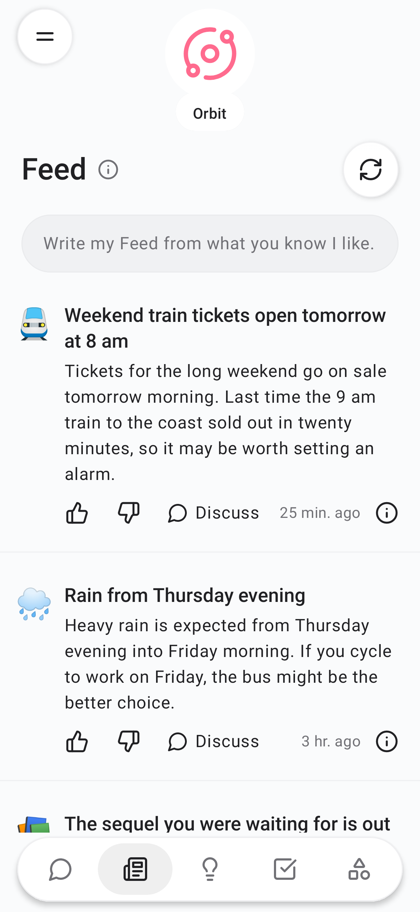
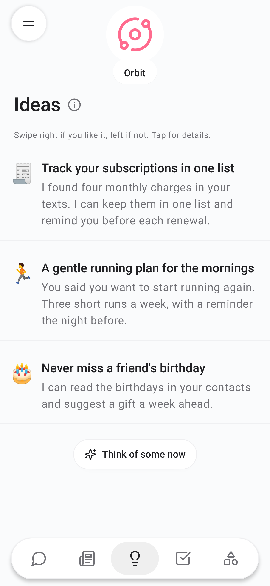

  <picture>
    <source media="(prefers-color-scheme: dark)" srcset="docs/assets/readme/orbit-banner-dark.svg">
    
  </picture>

  <b>A personal AI that lives on your Android phone, remembers you, and grows with you.</b>

  
  
  
  

  <a href="https://github.com/CATMIAOZHI/Operit/releases/latest">Download</a> ·
  <a href="#what-orbit-does">Features</a> ·
  <a href="#getting-started">Getting started</a> ·
  <a href="README.zh-CN.md">中文</a>

---

In a vast universe, you are the sun at the center, and Orbit is the planet that circles you. The logo says exactly that: the core is you; the ring and its two moons are Orbit.

Orbit is a long-term personal agent. It talks with you, remembers what matters, works quietly in the background, and speaks up only when something is worth your attention. Its home is your phone: its memory, files and the traces of its growth are stored on the device, so changing models or providers does not make it forget you.

Orbit ships inside **Operit Ry**, a personal distribution of [Operit](https://github.com/AAswordman/Operit) maintained by [Rainy / CATMIAOZHI](https://github.com/CATMIAOZHI).

## What Orbit does

  
  &nbsp;
  
  &nbsp;
  

<table>
<tr>
<td width="50%" valign="top">

**Remembers you** 
Facts, preferences, people and promises are kept in local memory files. Orbit learns from your corrections and turns methods that worked into reusable skills.

</td>
<td width="50%" valign="top">

**Works while you are away** 
Reminders, recurring tasks, and watches on notifications, texts, your calendar, web pages or places. A check that finds nothing new stays quiet and costs no tokens.

</td>
</tr>
<tr>
<td valign="top">

**Feed, Ideas and Goals** 
Short posts written around your interests, ideas for things to do together, and long-term goals it keeps track of with you.

</td>
<td valign="top">

**Gets things done on the phone** 
A browser it can sign in with (you can take over at any time), apps operated on a background screen, a Linux terminal, files, and helper agents for longer jobs.

</td>
</tr>
<tr>
<td valign="top">

**Reads with you** 
Read a book in [Legado](https://github.com/CATMIAOZHI/legado) and Orbit writes paragraph comments ahead of you, so its notes are already there when you arrive.

</td>
<td valign="top">

**Reaches you where you are** 
Chat and side chats, option buttons and reactions, voice messages, and a WeChat channel for talking without opening the app.

</td>
</tr>
</table>

### A few things people use it for

- *"Keep an eye on my messages and tell me about the important ones."*
- *"A parcel code just came in. Is it a new one?"*
- *"Remind me to work out every morning, and ask me again if I skip a week."*
- *"Remind me to take my keys when I leave home."*
- *"Tell me when this page changes."*
- *"Let's read this novel together."*

## Bring your own model

Orbit runs on the model you choose: OpenAI, Claude, Gemini, DeepSeek, OpenRouter, Ollama, LM Studio and other compatible endpoints. You add your own API key; requests go straight from your phone to that provider. Operit does not run a model service or relay your chats.

Weekly token allowances and usage statistics keep background work within a budget you set.

## Your data

- Memory, chats, tasks and files are stored on your device. You can export them at any time.
- When Orbit thinks, the context it needs (your messages, relevant memory, tool results) is sent to the model provider you configured. Read that provider's terms to know how it handles data.
- Websites and services Orbit uses on your behalf receive what is sent to them. Passwords and API keys go into a secure vault instead of the chat, and payment is always left to you.

## Getting started

1. Download the latest APK from [Releases](https://github.com/CATMIAOZHI/Operit/releases/latest). It needs Android 8.0 or later on an arm64 phone; 6 GB of RAM or more is recommended.
2. Install it, open the app and agree to the terms.
3. Add a model and its API key.
4. Open Orbit and say hello.

> Only download Operit Ry from this repository's Releases. Packages from other places may have been modified.

Orbit is part of a full Android AI assistant. Beyond Orbit, Operit offers a built-in Ubuntu environment, 40+ tools, MCP servers and Skills, tool packages and workflows, character cards and a floating window. See the [documentation](docs) for more.

## Builds and branches

| | Branch | Package | Updates |
|---|---|---|---|
| **Stable** | [`personal/main`](https://github.com/CATMIAOZHI/Operit/tree/personal/main) | `com.rainy.operitry` | [Releases](https://github.com/CATMIAOZHI/Operit/releases), patch updates between versions |
| **Dev** | [`personal/dev`](https://github.com/CATMIAOZHI/Operit/tree/personal/dev) | `com.rainy.operitry.dev` | [Nightly](https://github.com/CATMIAOZHI/OperitNightlyRelease) |

New features land in `personal/dev` first and move to `personal/main` after testing. The dev build installs alongside the stable one and official Operit.

## Contributing

Issues and pull requests are welcome on [CATMIAOZHI/Operit](https://github.com/CATMIAOZHI/Operit/issues). Please search for existing ones first, and keep API keys, tokens and cookies out of logs and screenshots.

- Build the app: [BUILDING.md](docs/doc-src/dev-core/BUILDING.md)
- Write scripts, Skills and tool packages: [SCRIPT_DEV_GUIDE.md](docs/SCRIPT_DEV_GUIDE.md)

## License and credits

Operit Ry is an unofficial distribution based on [AAswordman/Operit](https://github.com/AAswordman/Operit) and keeps the original copyright and license notices. Thanks to the upstream authors and every contributor.

Licensed under [LGPL-3.0](LICENSE).
