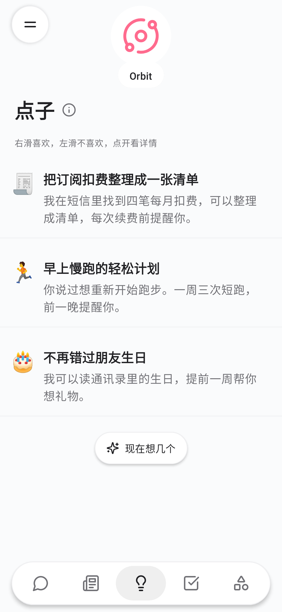
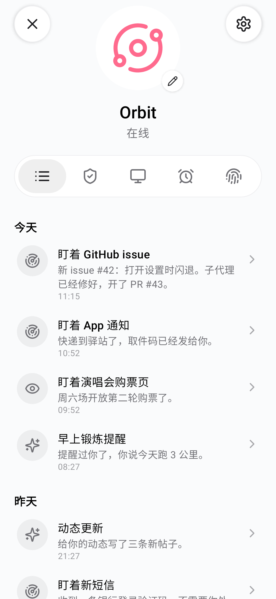
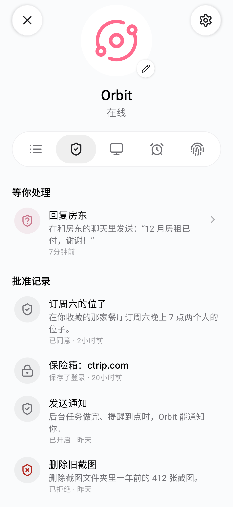
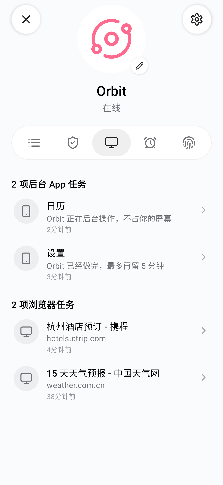
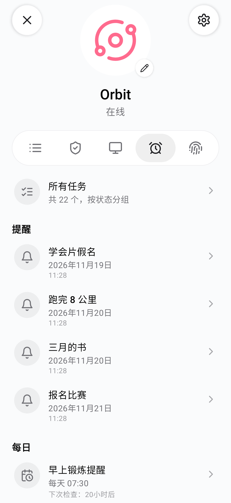
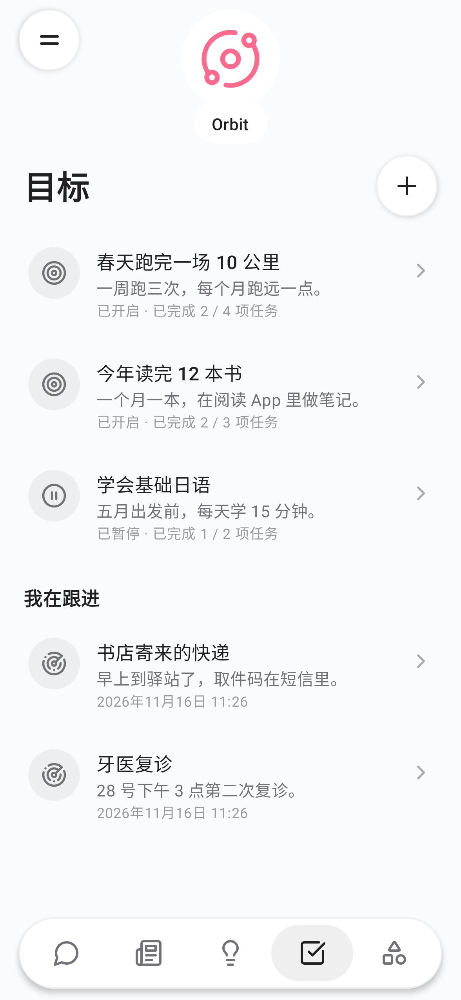
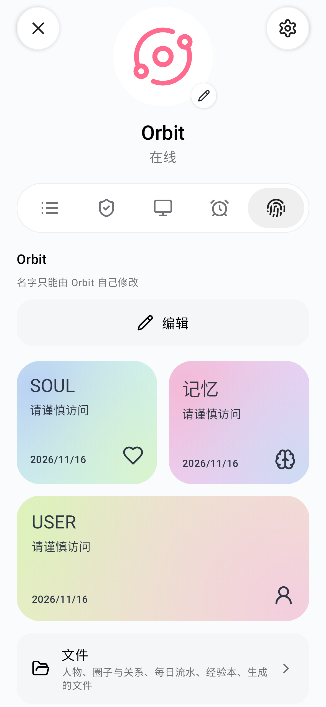

  <picture>
    <source media="(prefers-color-scheme: dark)" srcset="docs/assets/readme/orbit-banner-dark.svg">
    
  </picture>

  <b>住在你安卓手机里的本地优先私人 AI 伙伴——懂你、能动手干活、独一无二，和你一起成长。</b>

  
  
  
  

  <a href="https://github.com/CATMIAOZHI/orbit/releases/latest">下载</a> ·
  <a href="#为什么是-orbit">为什么是 Orbit</a> ·
  <a href="#核心能力">核心能力</a> ·
  <a href="#微信专属频道">微信频道</a> ·
  <a href="#开始使用">开始使用</a> ·
  <a href="README.md">English</a>

---

在广阔的宇宙里，你是中心的太阳，Orbit 是绕着你转的行星。图标说的就是这件事：中间的核心是你，外面的环和两颗卫星是 Orbit。

Orbit 是住在你安卓手机里的**本地优先**私人 AI 伙伴与助理。它把记忆、性格和文件留在你的设备上，不经中转服务器，靠日常相处、夜间复盘和纠错学习慢慢长成只属于你的那一个；它还自带 **Linux 终端、独立浏览器内核、后台操作安卓 App** 和**微信专属频道**，既能陪你聊，也能真替你办事。

  
  &nbsp;
  
  &nbsp;
  

## 为什么是 Orbit

| 亮点 | Orbit 的做法 |
|---|---|
| **本地优先** | 记忆、性格（`SOUL.md`）、聊天、文件、保险箱密钥和浏览器登录态都留在你手机里，无中转服务器 |
| **换模型不换「人」** | 自由切换主流云模型、OpenAI 兼容接口（含局域网）与多账户池，记忆和性格始终跟着设备走 |
| **越用越独一无二** | 夜间复盘对话、从你的纠正中学习、沉淀可复用技能（Skills），逐渐长成专属伙伴 |
| **能动手办实事** | 自带 Linux 终端、内置独立浏览器内核、后台虚拟屏操作安卓应用，并可连接微信专属频道 |

## 核心能力

- **本地记忆与持续进化**：事实、喜好、身边的人和约定存在本机的记忆与性格文件里。Orbit 会夜间复盘对话、从你的纠正里学习，把验证有效的做法沉淀成可复用的技能（Skills）。
- **内置 Linux 终端**：可直接跑脚本、写代码、拉仓库、处理本地文件，复杂长任务可派子代理协助。
- **内置独立浏览器内核**：拥有独立登录态，可查网页、填表、办事；需要输密码或过验证时，你随时可以点开接手，完事交还继续跑，平时也能手动打开自用。
- **后台操作安卓 App**：在后台虚拟屏里操作其他应用，不抢你当前屏幕，同样支持随时接管（需 Shizuku / ADB 调试或 Root，并受设备与应用支持限制）。
- **主动陪伴：动态、点子与目标**：围绕你的兴趣写短动态，提一起做的点子，并陪你长期跟进目标。
- **后台定时与监测**：提醒、定时任务，以及监测通知、短信、日历、网页或地点；支持程序预检的监测在没有变化时可保持安静、跳过模型调用。
- **专属声音与陪你读书**：配合小米 MiMo 可用文字描述设计声音或复刻音色，发送自然风格语音条（长按可转文字）；搭配兼容版 [阅读（Legado）](https://github.com/CATMIAOZHI/legado) 开启伴读后，Orbit 会提前写好段评，你读到那里批注已经在了。
- **可控、透明、安全**：你可以设置工具权限，需要确认的操作会先请你批准；任务运行记录与批准记录按天可查；通过安全卡片存入保险箱的密码与密钥加密保存在本地，使用时不会进入聊天上下文；付款永远只留给你自己。

## 微信专属频道

无需打开 App，就能在微信里像和普通好友聊天一样联系你的 Orbit：

- **扫码直连专属机器人**：在「设置 → 消息频道 → 微信」扫码绑定后，就能直接在微信里给 Orbit 发文字、语音（由微信转写文字）、图片和文件。
- **双向同步、独立归档**：Orbit 的回复、图片和文件会自动发回微信，并在 Orbit 里归档到独立的「微信」频道，方便回看，不混入主聊天。
- **频道权限边界清晰**：微信频道只接收发给专属机器人的消息，不会读取你的好友列表、群聊或其他微信聊天记录，也不能借此替你给别人发微信。

## 更多界面

<table>
<tr>
<td width="33%" align="center"> <b>任务运行记录</b>，按天排好</td>
<td width="33%" align="center"> <b>需要确认先问你</b>，都有记录</td>
<td width="33%" align="center"> <b>浏览器和后台 App</b>，随时能接手</td>
</tr>
<tr>
<td align="center"> <b>定时任务</b>，到点就办</td>
<td align="center"> <b>目标</b>，陪你一起跟进</td>
<td align="center"> <b>Soul 和记忆</b>，存在你的手机上</td>
</tr>
</table>

## 大家拿它做什么

- *“帮我盯着消息，重要的告诉我，广告和杂事别打扰我。”*
- *“刚来了个取件码，是新的吗？”*
- *“每天早上提醒我锻炼，要是我一周没练就再问问我。”*
- *“我出门的时候提醒我带钥匙。”*
- *“这个网页有变化就告诉我；需要登录的话叫我接手一下。”*
- *“帮我盯着 GitHub 的 issue，来了 bug 就派子代理在终端里修好、提 PR。”*
- *“用我喜欢的人设设计一个温柔点的声音，以后早安发语音条给我。”*
- *“在微信里随手丢给你一个链接，你帮我看完记下来。”*
- *“我们一起读这本小说吧。”*

## 用你自己的模型，控制你的额度

- **自由接入**：支持 OpenAI、Claude、Gemini、DeepSeek、OpenRouter、Ollama Cloud 等主流服务；自定义端点（含局域网模型）可按服务商协议选择 **OpenAI 通用**（Chat Completions）或 **OpenAI Responses通用**（Responses API）。
- **多账户池**：支持 ChatGPT、Claude、Grok、Antigravity、Command Code 账户登录并配置多个账户，额度用完、限流或失效时自动切换，也可随时手动指定。
- **手机直连**：订阅账户令牌和保险箱凭据在本机应用层加密保存，普通模型配置（含 API Key）保存在应用本地 DataStore；请求从手机直接发给你配置的服务商，我们不提供模型服务，也不中转你的聊天。
- **额度控制**：支持按**花费（美元）**或按 **token** 设定每周额度与额外额度，配合用量统计；达到本地额度后会暂停后续模型请求（按花费计费时仅统计有定价的模型）。

## 你的数据

- **默认留在本地**：记忆、性格、聊天、任务、文件、保险箱密钥和内置浏览器登录态默认保存在你的设备上；其中记忆、性格、聊天、任务和普通文件可随时导出（不含保险箱密钥与浏览器登录态）。
- Orbit 思考时，需要的上下文（你的消息、相关记忆、工具结果）会发给你配置的模型服务商。服务商怎么处理数据，请看它的条款。
- Orbit 替你使用的网站、语音或微信频道，会收到完成对应操作所需的内容。通过安全卡片保存并由工具调用的保险箱凭据不会进入聊天；付款永远由你自己来。

## 开始使用

1. 从 [Releases](https://github.com/CATMIAOZHI/orbit/releases/latest) 下载最新 APK。需要 Android 10 及以上的 arm64 手机，建议 6 GB 及以上内存。
2. 安装后打开 App，同意条款。
3. 添加一个模型（填 API Key 或登录已有账户）。
4. 打开 Orbit，跟它打个招呼。

> 只从 [CATMIAOZHI/orbit](https://github.com/CATMIAOZHI/orbit/releases) 或镜像仓库 [CATMIAOZHI/Operit](https://github.com/CATMIAOZHI/Operit/releases) 的 Releases 下载。其他地方的安装包可能被修改过。

Orbit 内置在 **Operit Ry** 中。除 Orbit 外，Operit Ry 还包含内置 Ubuntu 环境、40 多个工具、MCP 服务器与 Skills、工具包与工作流、角色卡和悬浮窗等能力，更多内容见[文档](docs)。

## 版本、仓库和分支

Orbit 在 [CATMIAOZHI/orbit](https://github.com/CATMIAOZHI/orbit) 开发和发布，[CATMIAOZHI/Operit](https://github.com/CATMIAOZHI/Operit) 是它的同步镜像；正式版发布后会同步到镜像仓库。反馈请提 [Issues](https://github.com/CATMIAOZHI/orbit/issues)，代码贡献请提 [Pull Requests](https://github.com/CATMIAOZHI/orbit/pulls)。

| | 分支 | 包名 | 更新 |
|---|---|---|---|
| **正式版** | [`main`](https://github.com/CATMIAOZHI/orbit/tree/main) | `com.rainy.operitry` | [Releases](https://github.com/CATMIAOZHI/orbit/releases)，版本之间走补丁更新 |
| **开发版** | [`dev`](https://github.com/CATMIAOZHI/orbit/tree/dev) | `com.rainy.operitry.dev` | [Nightly](https://github.com/CATMIAOZHI/OperitNightlyRelease) |

新功能先进 `dev`，测试后再晋升到 `main`。开发版可以和正式版、官方 Operit 同时安装。

## 参与贡献

欢迎在 [CATMIAOZHI/orbit](https://github.com/CATMIAOZHI/orbit) 提交 [Issues](https://github.com/CATMIAOZHI/orbit/issues) 和 [Pull Requests](https://github.com/CATMIAOZHI/orbit/pulls)。提之前先搜一下有没有重复的；日志和截图里不要带 API Key、令牌和 Cookie。

- 编译 App：[现行构建手册](docs/agent/build-guide.md)（另见 [BUILDING.md](docs/doc-src/dev-core/BUILDING.md)）
- 写脚本、Skills 和工具包：[SCRIPT_DEV_GUIDE.md](docs/SCRIPT_DEV_GUIDE.md)

## 许可和致谢

Orbit 内置在 Operit Ry 中；Operit Ry 是由 [水晴喵（WaterRainCat）](https://github.com/CATMIAOZHI) 维护、基于 [AAswordman/Operit](https://github.com/AAswordman/Operit) 的非官方个人发行版，保留原有的版权和许可声明。感谢上游作者和每一位贡献者。

采用 [LGPL-3.0](LICENSE) 许可。
